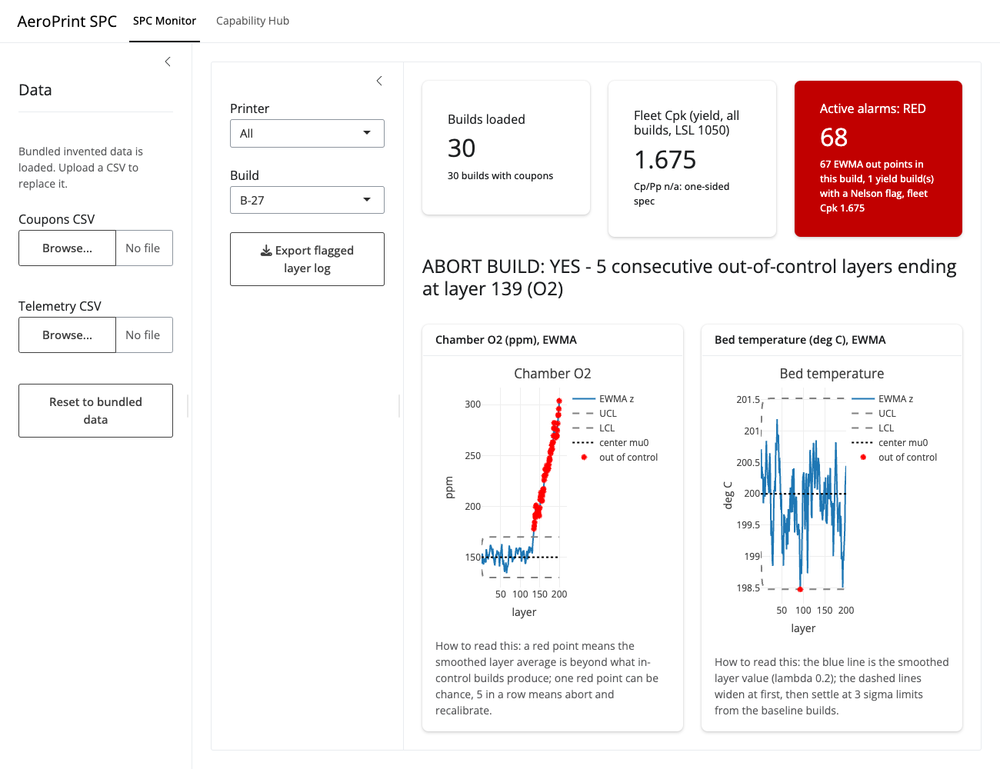
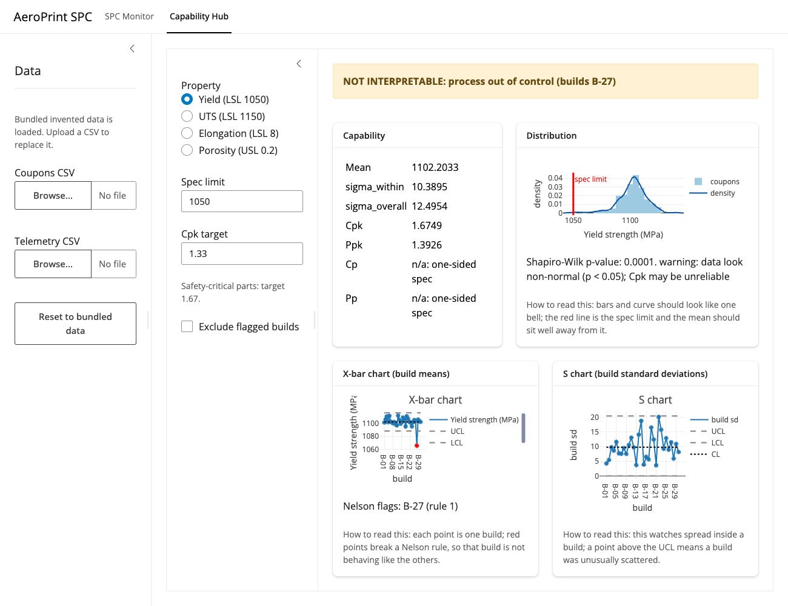
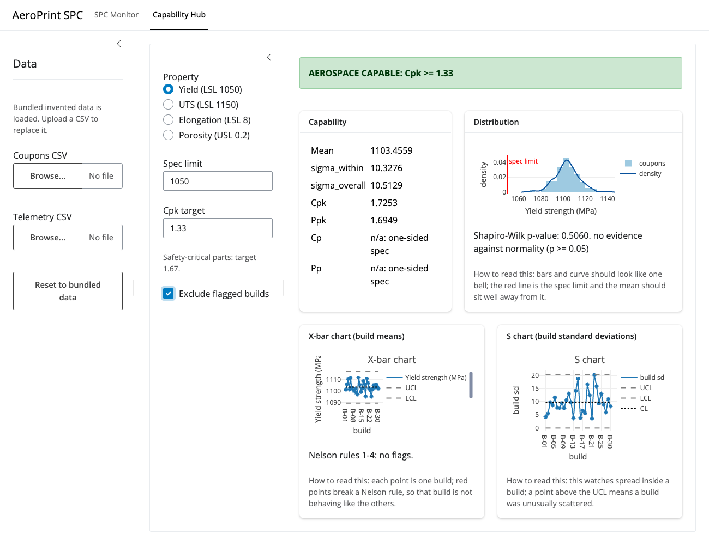

# AeroPrint SPC: demo walkthrough

This page shows the tool on each test file in `data/`. All data are INVENTED (see `data/README.md`).
Every number below was printed by `Rscript demo/run_demo.R`. Run it yourself from the repo root and
compare: the script uses the same functions and rules as the app.

- Live app (public, no login): <https://connect.systems-apps.com/content/894bc570-5881-4080-a60a-9650c3dafcfb/>
- Local app: `Rscript app/testme.R`, then open <http://127.0.0.1:8080>
- The app starts with `data/telemetry.csv` and `data/coupons.csv` already loaded.

The app has two pages: **SPC Monitor** (during a build) and **Capability Hub** (after the coupons are tested).

## How the baseline and abort rule work (same as the app)

- The EWMA center and sigma come from the baseline rows of `telemetry.csv` (`baseline == TRUE`, builds B-01 to B-20).
  O2: mu0 = 150.1560 ppm, sigma = 19.9287 ppm. Bed temp: mu0 = 199.9999 C, sigma = 1.5206 C.
- One red point can be chance, so the tool says **ABORT BUILD: YES** only after **5 consecutive** red layers.
- Only 1 of 30 builds aborts (B-27).

---

## 1. data/telemetry.csv: the in-build drift (page 1)

**What it represents:** layer averages of chamber O2 and bed temperature for 30 builds x 200 layers.
Build B-27 (printer C) has an O2 ramp from layer 120. Everything else is in control.

### 1a. The drifting build, B-27

Clicks, on the live URL:
1. Open the URL. You land on **SPC Monitor**.
2. Printer = **All**, Build = **B-27** (this is the default).

What you see (screenshot: `page1_b27.png`):
- Headline: **ABORT BUILD: YES - 5 consecutive out-of-control layers ending at layer 139 (O2)**.
- The O2 chart: the blue line sits inside the dashed limits, then climbs out. The first single red point is at
  layer 135. Layers 135 to 139 are five reds in a row, so the abort fires at layer 139. In total 66 O2 layers are red.
- The bed temp chart: 1 red point (layer 93) and no abort. That is a chance alarm.
- Mean O2 is 151.0 ppm for layers 1-119 and 283.5 ppm for layers 180-200.
- The alarm card says **Active alarms: RED**, with a count of 68 (67 EWMA out points in this build plus 1 yield build with a Nelson flag).



**How to read this:** a red point means the smoothed layer average is beyond what in-control builds produce.
Five in a row means the drift is real: abort the build and recalibrate printer C.

### 1b. A healthy build, B-01

Clicks: Printer = **All** (or A), Build = **B-01**.

What you see:
- **ABORT BUILD: NO**.
- O2 has 3 red layers (13, 15, 16) but never 5 in a row. Bed temp has 0 red layers.
- Chance alarms like this are normal. They are the reason for the 5-in-a-row rule: with the rule, 0 of the 29
  clean builds abort. Other clean builds with a lone red point include B-02 (O2) and B-05, B-06, B-07, B-10 (bed temp).
- The alarm card also reads RED. That is because it counts fleet-level alarms too: the yield Nelson flag on B-27
  (page 2) and the fleet Cpk are shown on every build. The abort line is the build-level answer.

**How to read this:** a lone red point does not mean abort. Look at the **ABORT BUILD** line, not at one dot.

Optional: press **Export flagged layer log** to download the red layers of the chosen build as a CSV.

---

## 2. data/coupons.csv: capability (page 2)

**What it represents:** 30 builds x 5 tensile coupons (yield, UTS, elongation, porosity). The process is capable,
except build B-27, whose coupons have low yield and elongation and high porosity.

Spec limits (editable in the sidebar): yield LSL 1050 MPa, UTS LSL 1150 MPa, elongation LSL 8 %, porosity USL 0.2 %.
All four limits are one-sided, so **Cp and Pp show "n/a: one-sided spec"**.

Clicks: top bar **Capability Hub**. Property radio buttons on the left. Leave "Exclude flagged builds" **unchecked** first.

### 2a. Yield, all 30 builds (screenshot: `page2_default.png`)

Property = **Yield (LSL 1050)**, checkbox off.

- Banner: **NOT INTERPRETABLE: process out of control (builds B-27)**.
- Why: the X-bar chart shows B-27 as a red point (build mean 1065.88, below the LCL 1088.26). Nelson rule 1 fires.
  The X-bar limits are CL 1102.20, UCL 1116.14, LCL 1088.26.
- Mean 1102.2033, sigma_within 10.3895, sigma_overall 12.4954.
- **Cpk = 1.6749**, **Ppk = 1.3926**. Cp = n/a, Pp = n/a.
- Shapiro-Wilk p-value: 0.0001, with the warning "data look non-normal (p < 0.05); Cpk may be unreliable".
  The B-27 outlier makes the data non-normal.



**How to read this:** a Cpk of 1.6749 looks good, but the tool refuses to call it capable because the process
was not stable. A capability number only means something for an in-control process.

### 2b. Yield, with "Exclude flagged builds" checked (screenshot: `page2_exclude.png`)

Tick **Exclude flagged builds**.

- Banner: **AEROSPACE CAPABLE: Cpk >= 1.33** (29 builds used).
- Mean 1103.4559, sigma_within 10.3276, sigma_overall 10.5129.
- **Cpk = 1.7253**, **Ppk = 1.6949**. Cp and Pp still n/a.
- Shapiro-Wilk p-value: 0.5060, "no evidence against normality".
- The X-bar chart says "Nelson rules 1-4: no flags."



**How to read this:** without B-27 the process is stable and its nearest spec limit is about 5 within-build sigmas
away (Cpk 1.7253 x 3). The batch can be released. B-27 is the one to investigate.
Ppk rises to meet Cpk once B-27 is gone: the gap between them (1.3926 vs 1.6749) was the B-27 shift.

### 2c. The other three properties

Click each radio button. Numbers with the checkbox off, then on:

| Property (limit) | Checkbox off: banner | Cpk | Ppk | Shapiro p | Checkbox on: banner | Cpk | Ppk | Shapiro p |
|---|---|---|---|---|---|---|---|---|
| Yield (LSL 1050) | NOT INTERPRETABLE (B-27) | 1.6749 | 1.3926 | 0.0001 | AEROSPACE CAPABLE | 1.7253 | 1.6949 | 0.5060 |
| UTS (LSL 1150) | NOT INTERPRETABLE (B-27) | 1.7496 | 1.5112 | 0.3119 | AEROSPACE CAPABLE | 1.7567 | 1.7153 | 0.8537 |
| Elongation (LSL 8) | NOT INTERPRETABLE (B-27) | 1.6379 | 1.3106 | 0.0000 | AEROSPACE CAPABLE | 1.6643 | 1.7489 | 0.1772 |
| Porosity (USL 0.2) | NOT INTERPRETABLE (B-27) | 2.3564 | 1.4330 | 0.0000 | AEROSPACE CAPABLE | 2.4510 | 2.3661 | 0.0000 |

More detail (mean, sigma_within, sigma_overall):
- UTS, all builds: 1212.6260, 11.9316, 13.8135. B-27 mean 1178.22 trips rule 1. Excluded: 1213.8124, 12.1082, 12.4009.
- Elongation, all builds: 10.9053, 0.5913, 0.7389. B-27 mean 8.34 trips rule 1. Excluded: 10.9938, 0.5996, 0.5706.
- Porosity, all builds: 0.0598, 0.0198, 0.0326. B-27 mean 0.20 trips rule 1. Excluded: 0.0551, 0.0197, 0.0204.

**Porosity skew caveat:** porosity cannot go below 0, so its histogram has a long right tail. The Shapiro-Wilk
p-value is 0.0000 both with and without B-27, so the tool shows the non-normal warning in both cases.
The porosity Cpk (2.3564 and 2.4510) is a normal-theory number and is probably too optimistic: treat it as
an approximation, not a result.

Elongation also shows the warning when B-27 is included (p 0.0000), but passes once B-27 is excluded (p 0.1772).
One small oddity: elongation Ppk (1.7489) is slightly above Cpk (1.6643) after excluding B-27. That can happen
when there is no build-to-build shift, because the two sigmas are estimated different ways.

**How to read this:** Cpk 1.33 means the nearest spec limit is 4 within-build sigmas from the mean (3 x 1.33).
Pick the safety-critical target 1.67 in the "Cpk target" box to be stricter.

---

## 3. data/edge_case.csv: the clear error messages

**What it represents:** 6 coupons in 2 builds, built to break the maths on purpose.
- **E-01**: 5 coupons, all identical (yield 1100). The spread is zero.
- **E-02**: a single coupon. One value has no spread to measure.

Clicks, on the live URL:
1. Open the **Capability Hub** page (or stay on any page: the sidebar is shared).
2. In the left sidebar, under **Coupons CSV**, press **Browse...** and choose `data/edge_case.csv`.
3. A green note says "Coupons file loaded." Capability Hub, Property = **Yield**.

What you see (the app does not crash):
- A red notification and a grey banner starting **CANNOT COMPUTE: need at least 2 coupons per build**.
- Under the banner, one line per build, saying what is wrong with each:
  - E-01: zero variation: capability undefined (the app adds "; Cp/Pp n/a: one-sided spec")
  - E-02: need at least 2 coupons per build
- No Cpk, no chart. Nothing is made up.

Checked by `run_demo.R`:
- Whole file, yield: error = need at least 2 coupons per build
- E-01 alone: Cpk = NA, Ppk = NA, message = zero variation: capability undefined; Cp/Pp n/a: one-sided spec
- E-02 alone: need at least 2 coupons per build

**How to read this:** zero spread gives an undefined Cpk (not infinity, not 0), and one coupon per build is not
enough to estimate spread. The tool says so in words.

To go back, press **Reset to bundled data**.

---

## Known answer (SPEC section 4, worked by hand)

Yield, 3 builds x 3 coupons: B1 = 1100, 1110, 1120; B2 = 1090, 1100, 1110; B3 = 1110, 1120, 1130; LSL = 1050.
Each build s = 10, so s-bar = 10. c4(3) = 0.8862, so sigma_within = 10 / 0.8862 = 11.284.
Cpk = 60 / (3 x 11.284) = 1.772. Overall s = sqrt(1200 / 8) = 12.247, so Ppk = 60 / (3 x 12.247) = 1.633.
X-bar limits = 1110 +/- 1.954 x 10 = 1090.46 / 1129.54. S upper limit B4 x s-bar = 25.68.

EWMA: mu0 = 100, sigma = 10, lambda = 0.2, L = 3, x = 100, 100, 150 gives z3 = 110, UCL1 = 106.00,
UCL3 = 108.59, so point 3 is out.

`Rscript demo/run_demo.R` prints (last lines):

```
Cpk = 1.772, Ppk = 1.633, X-bar limits = 1090.46 / 1129.54, B4 s-bar = 25.68
EWMA z3 = 110.00, UCL1 = 106.00, UCL3 = 108.59, point 3 out = TRUE
```

The automated proof, from the repo root:

```
Rscript -e "testthat::test_dir('tests')"
```

## Regenerate this page's numbers

```
Rscript demo/run_demo.R
```

The screenshots were taken from the live URL with a short Playwright script (kept outside the repo).
